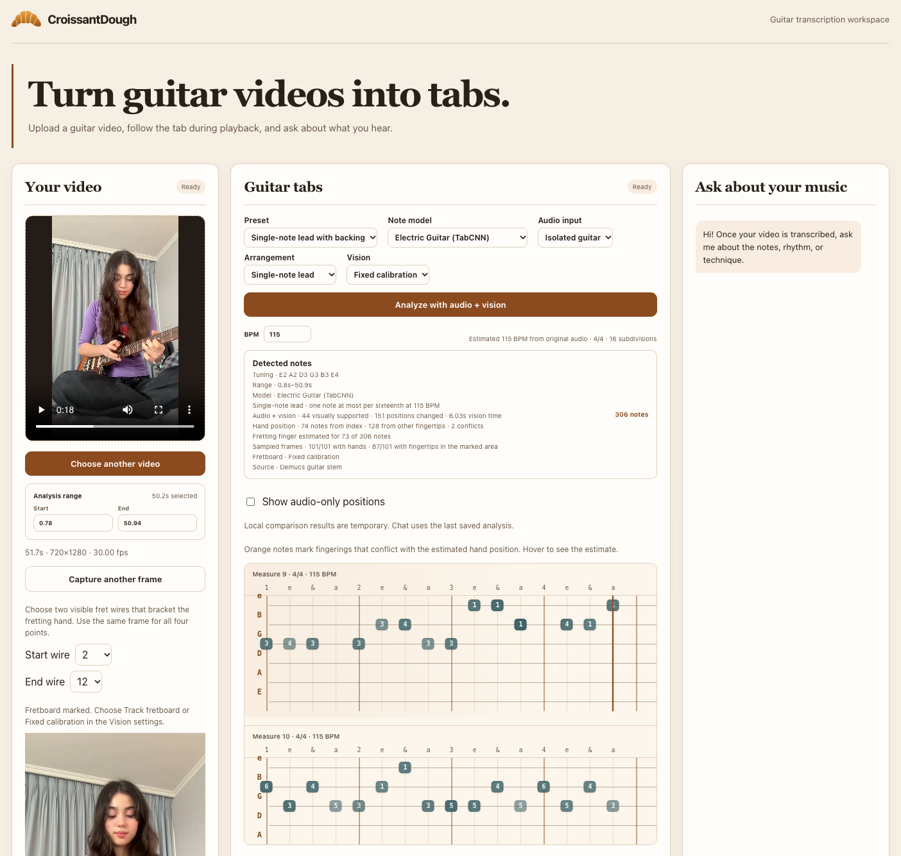

# CroissantDough

CroissantDough turns short guitar performance videos into tablature that follows video playback. Audio estimates what was played and when. Optional local vision helps choose the string and fret when the same pitch can be played in several positions.

**Group 74 · Generative AI project · Dr. Charchit Chandra**

[Technical report (PDF)](docs/CroissantDough-Technical-Report.pdf) · [Benchmark methods and results](BENCHMARK.md)



The screenshot shows the current interface replaying saved results for Lizzie Skevington’s *Realiti* cover.

## Run locally

### Prerequisites

- Python 3.11 and [uv](https://docs.astral.sh/uv/)
- Node.js 22.12 or newer and npm
- FFmpeg and ffprobe on your PATH
- Internet access to install dependencies. The first use of **Isolated guitar** also downloads the Demucs weights.

The development and evaluation environment was macOS on Apple Silicon. Audio transcription and calibrated local vision run on CPU and require no API keys. Git includes the GuitarProFX TabCNN and MediaPipe hand landmark model files.

On macOS with Homebrew, install FFmpeg and uv with `brew install ffmpeg uv`.

### Start the backend

```bash
git clone https://github.com/xSidnt/genai_proj.git croissantdough
cd croissantdough/backend
uv sync --locked --python 3.11
uv run --locked python -m uvicorn app.main:app --host 127.0.0.1 --port 8000
```

Visit [API docs](http://127.0.0.1:8000/docs) or run `curl -fsS http://127.0.0.1:8000/api/health`. The health response is `{"status":"ok"}`.

### Start the frontend

In a second terminal, from the repository root, run:

```bash
cd frontend
npm ci
npm run dev -- --host 127.0.0.1 --port 5173 --strictPort
```

Open [CroissantDough](http://127.0.0.1:5173). The frontend calls the API on port 8000. The backend accepts browser requests from port 5173 on localhost or 127.0.0.1.

## Reproduce the demo

### Audio-only transcription

1. Upload an MP4, MOV, or WebM clip with an audio track. The app accepts up to 60 seconds and 100 MB. For a first run, use a short solo guitar clip in standard tuning.
2. Keep **Solo electric guitar** selected. This uses **Electric Guitar (TabCNN)**, **Original audio**, **Melody and chords**, and **Vision Off**.
3. Select a time range of at least 0.5 seconds and click **Analyze selected range**.
4. Start playback to follow the tab. Hover over a fret number for the detected timestamp and available note details. Adjust **BPM** if the estimated grid is off. Reanalyze to apply an updated BPM to single-note lead selection.

| Preset | Settings | Use |
| --- | --- | --- |
| Solo electric guitar | TabCNN, original audio, melody and chords, vision off | Solo electric guitar and chord passages |
| Pitch and timing | Basic Pitch with playable fingering, original audio, melody and chords, vision off | Compare audio pitch and onset detection |
| Single-note lead with backing | TabCNN, isolated guitar, single-note lead, fixed calibration | One lead part over accompaniment with a visible fretting hand |

### Audio and local vision

1. Pause on a clear frame where two identifiable fret wires surround the playing area. Click **Calibrate fretboard** and choose their numbers. Use **Nut** for fret zero.
2. Mark the four points in the order shown by the app: low E then high e on the start wire, followed by high e then low E on the end wire.
3. Choose **Fixed calibration** to reuse that mapping or **Track fretboard** to update it as the neck moves. Click **Analyze with audio + vision**.
4. Use **Show audio-only positions** to compare the original and vision-assisted string and fret positions for the same detected notes. Amber notes indicate a conflict with the estimated hand position. A calibrated comparison is temporary. Audio-only analysis is saved for its selected range.

### Realiti case study

The report used the 51.7-second Lizzie Skevington cover and the [published lead-guitar tab](https://www.songsterr.com/a/wsa/lizzie-skevington-realiti-tab-s3267244). If you have the same cover clip, use these settings:

| Setting | Value |
| --- | --- |
| Analysis range | 0.78–50.94 seconds |
| Preset | Single-note lead with backing |
| BPM override | 115 |
| Calibration | A frame near 1.03 seconds with wires 2 and 12 marked |
| Comparison | Vision off, fixed calibration, and tracked fretboard |

The report explains how the 24-bar reference was timed and scored. Supply your own copy of the same cover to rerun inference. The screenshot and reported results are available in this repository.

## How it works

1. **Media preparation.** FastAPI validates the upload. ffprobe reads duration and frame rate, and FFmpeg extracts and trims the audio. The selected range feeds the note detector. Demucs `htdemucs_6s` optionally separates the guitar stem, with original audio used if separation fails.
2. **Audio transcription.** GuitarProFX TabCNN classifies fret or silence independently on each of six strings from short constant-Q windows. Adjacent frames become note events. Basic Pitch supplies evidence of repeated attacks and can also run as a standalone pitch detector. The tempo estimator provides the beat grid.
3. **Local vision.** OpenCV rectifies the marked fretboard and can attempt to re-anchor to the reference as the neck moves. MediaPipe detects hand landmarks near audio note onsets. Fingertip positions, index-finger reach, and three two-string zones provide evidence about plausible frets and strings.
4. **Playable tab selection.** A Viterbi-style search ranks pitch-compatible positions and penalizes difficult transitions. Vision changes the estimated placement while preserving the audio pitch and onset. The browser renders the resulting tab against video playback.

```text
frontend/src/                 React and TypeScript interface
backend/app/upload/           Video validation and upload metadata
backend/app/audio/            Audio extraction, separation, models, and fingering
backend/app/video/            Fretboard geometry, landmark evidence, and tracking
backend/app/transcription/    Analysis orchestration, API, and SQLite persistence
backend/storage/models/       Bundled TabCNN and MediaPipe model files
backend/scripts/              Evaluation scripts
backend/tests/                Local fingering and vision regression tests
docs/                         Technical report and application screenshot
```

## Results and reproducibility

The audio runs compare the same GuitarProFX checkpoint on original audio before and after attack refinement. Exact-tab F1 scores a correct string and fret with an onset within ±50 ms. Missed and extra notes reduce F1.

| Audio benchmark | Raw GuitarProFX TabCNN | CroissantDough audio pipeline |
| --- | ---: | ---: |
| EGSet12, 12 recordings | 36.6% | **42.5%** |
| Guitar-TECHS, 12 amplifier-microphone recordings | 22.8% | **24.0%** |

On *Realiti*, the three isolated-lead variants shared 303 scored predictions and 59.5% pitch F1. Their differences reflect string and fret placement over the same audio detections.

| Realiti vision mode | Exact matches out of 295 | Exact-tab F1 at ±50 ms |
| --- | ---: | ---: |
| Off | 63 | 21.1% |
| Fixed calibration | **137** | **45.8%** |
| Track fretboard | 133 | 44.5% |

Vision depends on calibration and hand visibility. The tapping passage remained difficult, and vision cannot recover notes that the audio model missed. The single-note lead filter limits output to one attack per sixteenth-note slot and can remove genuine notes in polyphonic passages.

### Run the benchmark scripts

Download the datasets from their linked releases. Run these commands from `backend/` after dependency installation.

```bash
# EGSet12 expects a folder containing the paired WAV and JAMS files.
uv run --locked python -m scripts.benchmark_egset12 /path/to/EGSet12 \
  --include-isolated --original-tabcnn-weights /path/to/tabcnn.onnx

# Guitar-TECHS accepts the P3_music.zip archive directly.
uv run --locked python -m scripts.benchmark_guitar_techs /path/to/P3_music.zip

# GuiFiR-Vid accepts an extracted clip folder and the test annotation file.
uv run --locked python -m scripts.benchmark_guifir /path/to/raw_clips \
  /path/to/guifir_test_coco_anno_box.jsonl
```

See [BENCHMARK.md](BENCHMARK.md) for the exact GuiFiR clip list, reference construction, tolerance comparisons, and the dense video evaluator. The original TabCNN weights used for the separate EGSet12 baseline are available from the [ONNX model export](https://huggingface.co/cstr/tabcnn-onnx).

### Verify the setup

Run the backend tests from `backend/`:

```bash
uv run --locked python -m unittest discover -s tests -v
```

Run the frontend checks from `frontend/`:

```bash
npm run lint
npm run build
```

### Troubleshooting

- **The upload fails.** Check the backend health endpoint and confirm the video has audio, uses a supported format, and fits the upload limits.
- **Analyze with audio + vision is disabled.** Complete all four calibration marks and confirm a valid time range.
- **A first run takes a while.** For a quick first check, use **Original audio**, a short range, and **Vision Off**. Demucs downloads on first use and runs on CPU. Check **Source** in the results to see whether the app used the separated stem or fell back to original audio.

## Sources and model credits

- GuitarProFX weights by Pedroza, Abreu, Corey, and Roman. The bundled [ONNX export by cstr](https://huggingface.co/cstr/tabcnn-onnx) is CC BY 4.0. [GuitarProFX paper](https://www.dafx.de/paper-archive/2024/papers/DAFx24_paper_99.pdf)
- Original TabCNN by Wiggins and Kim. [TabCNN paper](https://zenodo.org/records/3527800)
- [Spotify Basic Pitch](https://github.com/spotify/basic-pitch) · [Meta Demucs](https://github.com/facebookresearch/demucs) · [Google MediaPipe Hand Landmarker](https://ai.google.dev/edge/mediapipe/solutions/vision/hand_landmarker)
- Evaluation datasets. [EGSet12](https://zenodo.org/records/11406378) · [Guitar-TECHS](https://zenodo.org/records/14963133) · [GuiFiR-Vid](https://github.com/kmu-ee-ailab/guifir_dataset)
